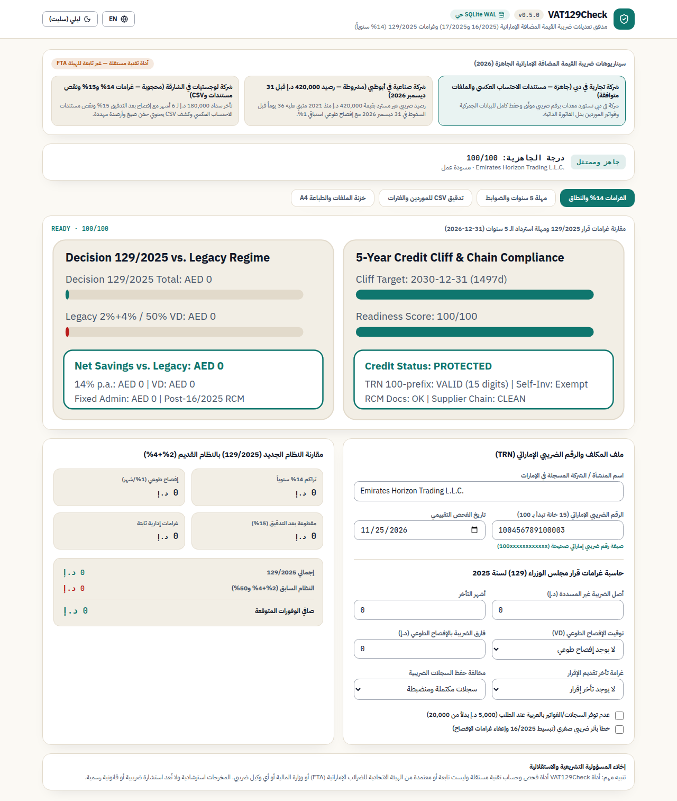
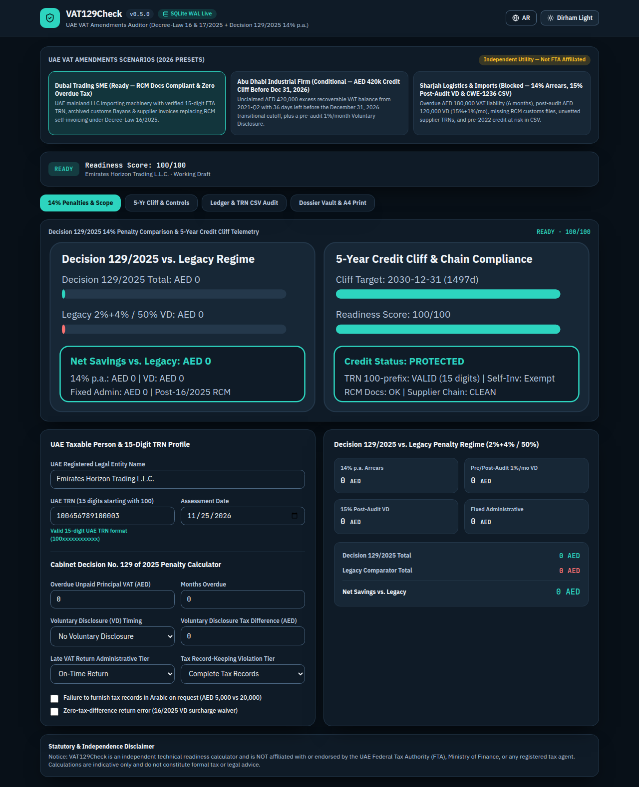
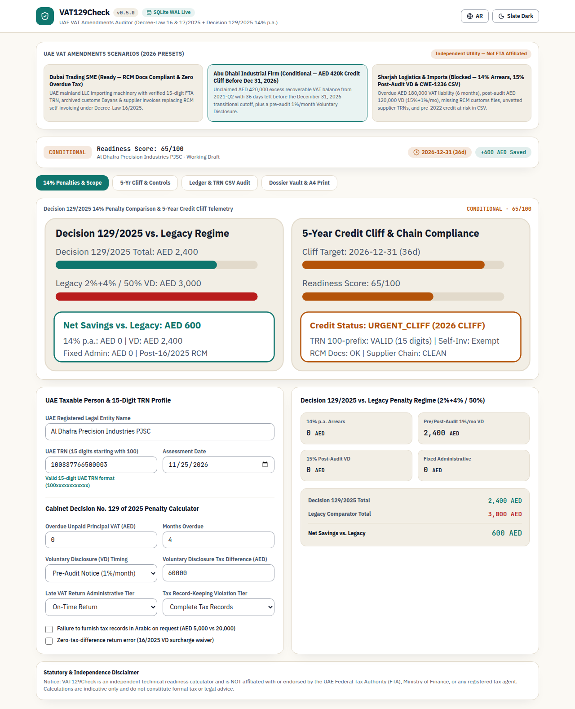
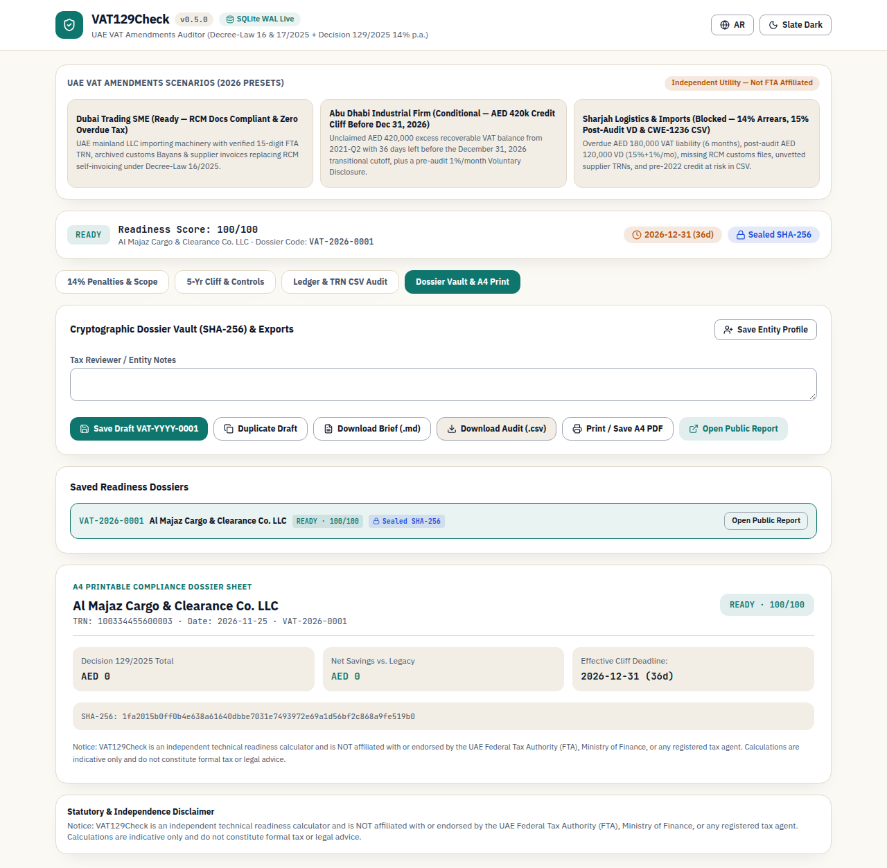
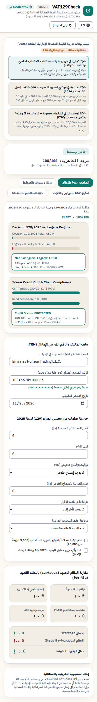
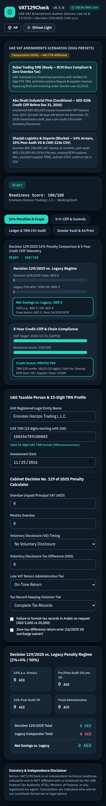

# VAT129Check — UAE VAT Amendments (`16/2025`, `17/2025` & `129/2025`) Readiness Studio

[](LICENSE)

> **Bilingual (`AR RTL` `Dirham Vellum` Light & `EN LTR` `Emirates Slate` Dark) · Dual-Mode (`Node 22 + SQLite WAL` or `$0` Browser Static Mode)**

Zero-runtime-backend-dependency technical readiness calculator, SQLite WAL API server, and bilingual **Arabic (`RTL`) / English (`LTR`)** web application covering the UAE Value Added Tax overhaul:

- **Cabinet Decision No. 129 of 2025** *(effective 2026-04-14)*:
  - Replaces legacy compound `2% + 4%/month` (`300%` cap) late-payment fines with a flat **`14%` p.a.** accrual (`1.1667%/month`) — flagging unbounded `>= 12` month exposure.
  - Compares pre-audit Voluntary Disclosure (**`1%/month`**) against post-audit notification (**`15% + 1%/month`**), standardized late-return (`AED 1,000 / 2,000`), record-keeping (`AED 10,000 / 20,000`), and reduced Arabic-record omission (`AED 5,000` vs. legacy `AED 20,000`) penalties.
  - Models zero-tax-difference return error simplification without automatic VD percentage surcharges.
- **Federal Decree-Law No. 16 & 17 of 2025** *(effective 2026-01-01)*:
  - Evaluates the **`Article 74` 5-year recoverable excess VAT credit expiry** and alerts on the **`2026-12-31`** transitional cliff for historical `2020–2021` unclaimed credits.
  - Validates the Reverse Charge Mechanism (RCM) **self-invoicing exemption** when foreign invoices, UAE Customs Bayans, and commercial contracts are retained.
  - Checks domestic supplier **15-digit UAE TRNs** (`100xxxxxxxxxxxx`) against supply-chain tax-evasion risk and audits batch ledger CSVs with **`CWE-1236` formula injection neutralization** and **`UTF-8 BOM` (`EF BB BF`)** export.

> **Independence & Legal Disclaimer**: VAT129Check is an independent technical utility and is **NOT affiliated with, endorsed by, or connected to** the UAE Federal Tax Authority (`FTA`), UAE Ministry of Finance (`MoF`), or any registered tax agent. All outputs are indicative and do not constitute tax, accounting, or legal advice.

---

## Visual Showcase (`AR RTL` & `EN LTR`)

### Desktop Arabic RTL (`Dirham Vellum` Light — Dubai Trading SME `100/100`)


### Desktop English LTR (`Emirates Slate` Dark)


### Abu Dhabi Credit Cliff Conditional (`AED 420k` Before `2026-12-31`, `36d` Left)


### Remediated Portfolio CSV & Sealed `VAT-2026-0001` Dossier (`SHA-256`)


### Mobile Arabic RTL View (`Dirham Vellum`, `390x844`)


### Mobile English LTR View (`Emirates Slate`, `390x844`)


---

## Quick Start (Local)

```bash
npm install
npm run typecheck
npm test
npm run build
npm start
# Opens HTTP + node:sqlite WAL backend on http://127.0.0.1:4227/vat129check
```

Run headless Chrome Playwright end-to-end tests:

```bash
npm run test:e2e
```

## `$0` Static Deploy (Cloudflare Workers Assets)

```bash
npm run build
npx wrangler deploy
```

When served without the Node backend, the UI automatically runs in **Browser `$0` Mode**, keeping all calculation engines (`src/core/*`), SHA-256 sealing, Markdown briefs, and BOM CSV exports working via `localStorage`.

## Self-Hosted Docker / SQLite WAL Deploy

```bash
docker compose up -d --build
# Runs Node 22 built-in HTTP + SQLite WAL persistence on 127.0.0.1:4227
```

## Key API Endpoints (Node 22 Built-In Server)

| Method & Route | Description |
|---|---|
| `GET /health`, `GET /readyz` | Liveness & SQLite WAL readiness probes (exempt from rate limits) |
| `GET /api/presets` | Three realistic UAE 2026 SME & logistics test scenarios |
| `POST /api/penalty` | Cabinet Decision `129/2025` `14%` & VD calculator vs. legacy comparator |
| `POST /api/credit-cliff` | `5-year` credit cutoff, `2026-12-31` transitional cliff & RCM check |
| `POST /api/audit-csv` | Batch period/supplier CSV auditor (`CWE-1236` safe + `UTF-8 BOM`) |
| `POST /api/assess` | Full assessment with 6 controls & canonical `SHA-256` digest |
| `GET/POST /api/dossiers` | Persistent `node:sqlite WAL` dossier vault (`VAT-YYYY-0001` atomic codes) |
| `POST /api/dossiers/:code/finalize` | Cryptographically seal dossier & generate shareable public slug |
| `GET /api/dossiers/:code/brief.md` | Download bilingual (`?lang=ar` or `en`) Markdown compliance brief |
| `GET /api/dossiers/:code/export.csv` | Download `UTF-8 BOM` CSV audit report (`CWE-1236` sanitized) |
| `GET /api/public/reports/:slugOrCode` | Public read-only sealed report JSON with persistent view counter |

## License

MIT
